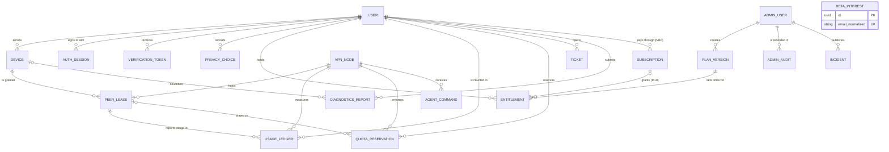

# Entities and data model

Draft — M01 — 15 Oct 2026 — pending review by backend and ops leads

Source: team pack 03 ("Entities (migrate and index explicitly)", "Quota and device enforcement"), 02 (admin views), 04 (retention) and M04, M07 and M10. The API side is in [`contracts/openapi.yaml`](../../contracts/openapi.yaml). Anything marked **Proposed** is a design choice that the pack does not fix.

Conventions (Proposed): PostgreSQL; `uuid` primary keys; `timestamptz` values written in UTC; byte columns are `bigint` with `CHECK (x BETWEEN 0 AND 9007199254740991)` to match the API's safe-integer rule. Usage is counted in bytes and displayed in GiB (1 GiB = 1,073,741,824 bytes). A quota period starts at 00:00 UTC on the first calendar day of the month.

## Entity dictionary

| Entity | Key fields | Uniqueness and constraints | Indexes (Proposed) |
|---|---|---|---|
| **User** | `id`; `email`, `email_normalized`, `email_verified_at`; `password_hash` (Proposed: Argon2id, parameters set in M04); `status` (Proposed: `active`, `suspended`, `deletion_pending`); `created_at`, `deleted_at` | Unique `email_normalized`. Proposed: deletion anonymizes the email to NULL, so the address can sign up again | `status`; `created_at` |
| **AdminUser** | Separate from User. `id`; `email`, `email_normalized`, `email_verified_at`; `password_hash`; MFA factor references (Proposed: `admin_mfa_factor` rows, secrets encrypted at rest); `role` (`owner`, `operator`, `support`, `read_only`); `status`; Proposed `admin_session` rows: `token_hash`, `mfa_verified_at`, `step_up_at`, `expires_at`, `revoked_at` | Unique `email_normalized`; one row per person, no shared accounts; Proposed unique `admin_session.token_hash` | `role`; `admin_session (admin_user_id) WHERE revoked_at IS NULL` |
| **Device** | `id`; `user_id`; `public_key` (WireGuard, base64); `label`; `enrolled_at`, `revoked_at`; Proposed `revocation_confirmed_at` | Unique `public_key`, Proposed across all rows including revoked ones. The device limit is checked in the enrollment transaction (Proposed: lock the user row, count active devices) | `(user_id) WHERE revoked_at IS NULL` |
| **AuthSession** | `id`; `user_id`; `refresh_token_hash`; `expires_at`; rotation and revocation state (`rotated_at`, `revoked_at`, `revoke_reason`); Proposed `family_id` (refresh reuse detection), `client_type`, `created_at`, `last_refreshed_at` | Unique `refresh_token_hash` | `(user_id) WHERE revoked_at IS NULL`; `expires_at` (cleanup) |
| **VerificationToken** | `id`; `user_id`; `purpose` (`email_verification`, `password_reset`, `email_change`); `token_hash`; `expires_at`; `used_at`; Proposed `new_email` for `email_change` | Unique `token_hash`; single use (`used_at` is set once). Proposed: a new token voids earlier unused tokens with the same purpose | `(user_id, purpose) WHERE used_at IS NULL`; `expires_at` |
| **PrivacyChoice** | `user_id`; `setting` (`crash_reports`, `diagnostics`); `value`; `changed_at`; `privacy_text_version` | Proposed: append-only history; the current value is the newest row per `(user_id, setting)` | `(user_id, setting, changed_at DESC)` |
| **PlanVersion** | `id`; `tier` (`free`, `premium`); `version`; `quota_bytes`; `device_limit`; `eligible_location_ids` (region eligibility); `effective_from`; `created_at`, `created_by` (AdminUser) | Unique `(tier, version)`; immutable (see Invariants) | `(tier, effective_from)` |
| **Entitlement** | `id`; `user_id`; `plan_version_id`; `starts_at`, `ends_at`; `source` (`free_default`; `play_subscription` and `admin_grant` from M10); `state`; Proposed `subscription_id` (M10) | Server-derived only. Proposed: at most one `active` entitlement per user (partial unique index) | `(user_id) WHERE state = 'active'`; `ends_at` |
| **VpnNode** | `id`; `provider_ref`; `region`, `city`; Proposed `location_id` (public catalog key); `public_endpoint`; `public_key`; `health`; capacity (Proposed `max_active_leases`, from M08 load tests); `lifecycle`; `last_heartbeat_at`; Proposed agent credential serial for revocation | Unique `public_key`; Proposed unique `provider_ref` and `public_endpoint`. No node private key, provider token or management credential | `(location_id, lifecycle, health)` |
| **PeerLease** | `id`; `device_id`; `node_id`; `assigned_ipv4`, `assigned_ipv6`; `state` (`active`, `revoking`, `ended`); `desired_state`, `actual_state`, `provisioning_state` (`pending`, `ready`, `failed`); `renew_after`, `expires_at`; `idempotency_key`; `end_reason`, `ended_at`; Proposed `user_id` and `tier` copied at grant for the constraint | Unique active free lease: partial unique `(user_id) WHERE state = 'active' AND tier = 'free'`. Unique `(user_id, idempotency_key)`. Unique `(node_id, assigned_ipv4)` and `(node_id, assigned_ipv6)` while `state <> 'ended'` | `(node_id, state)`; `(expires_at) WHERE state <> 'ended'` (expiry sweep); `device_id` |
| **UsageLedger** | `id`; `user_id` (account); `period_start`; `node_id`; `lease_id`; `byte_delta` (peer RX+TX, at least 0); `counter_epoch`; `sequence`; `sampled_at`, `recorded_at` | Unique `(lease_id, counter_epoch, sequence)`; insert-or-ignore on retry | `(user_id, period_start, sampled_at)`; Proposed monthly partitions by `period_start` (retention: current and previous period, 04) |
| **QuotaReservation** | `id`; `user_id`; `period_start`; `node_id`; Proposed `lease_id`; `allocated_bytes`, `consumed_bytes`, `returned_bytes`; Proposed `state` (`open`, `closed`), `created_at`, `closed_at` | All byte columns at least 0; `returned_bytes <= allocated_bytes`. Allocation is atomic and account-wide (see Invariants) | `(user_id, period_start) WHERE state = 'open'`; `(node_id, state)` |
| **AgentCommand** | `id`; `node_id`; `type` (typed enum, Proposed: `grant_peer`, `revoke_peer`, `set_allocation`, `drain`, `quarantine`); schema-validated `payload`; `desired_generation`; `acknowledged_at`, `acknowledged_generation`, `error_code`; Proposed `issued_at`, `attempts` | Unique `(node_id, desired_generation)`. No free-text or shell commands | `(node_id) WHERE acknowledged_at IS NULL` |
| **AdminAudit** | `id`; `actor_admin_id`; Proposed `actor_role`; `action`; `object_type`, `object_id`; `reason`; Proposed `request_id`; `created_at` (UTC) | Append-only (Proposed: INSERT-only grant; only the retention job deletes, proposed after 90 days, 04). No secrets, request bodies or traffic destinations | `created_at`; `(object_type, object_id, created_at)`; `(actor_admin_id, created_at)` |
| **Ticket / Incident** | Ticket: `id`, `user_id`, `subject`, `status`, `created_at`, `closed_at`, `retention_expires_at`; Proposed `ticket_message` rows (`author`, `body`). Incident: `id`, `title`, `status`, `impact`, `component_ids`, `visibility`, `created_by`, `started_at`, `resolved_at`; Proposed append-only `incident_update` rows | Minimally necessary content; proposed retention 90 days after close (04). Incidents hold no user data | `ticket (user_id, created_at)`; `ticket (retention_expires_at)`; `incident (visibility, status)` |
| **DiagnosticsReport** | `id`; `user_id`; `device_id` (nullable); `consented_at`; `payload_ref` (redacted payload reference); `app_version`; `retention_expires_at`; Proposed `privacy_text_version`, `received_at` | Proposed 30-day retention (04). No destinations or browsing data | `retention_expires_at`; `(user_id, received_at)` |
| **BetaInterest** | `id`; `email`, `email_normalized`; `consent_text_version`, `consented_at`; `source`; `confirmed_at`, `withdrawn_at`; Proposed `confirm_token_hash`, `withdraw_token_hash` | Proposed unique `email_normalized` and token hashes. Deleted when withdrawn or 90 days after public launch (04 proposal) | `(confirmed_at) WHERE withdrawn_at IS NULL` |
| **Subscription (M10)** | `id`; `user_id`; provider token reference (Proposed: `purchase_token_hash` plus encrypted token); `product_id`; `verified_state`; `expires_at`; linked token (Proposed `linked_purchase_token_hash`); dedupe IDs (Proposed `order_id`, processed notification IDs); Proposed `last_verified_at` | Unique `purchase_token_hash`: one account per token (replay protection). Proposed unique `order_id` and notification ID | `user_id`; `expires_at` (reconciliation) |

Supporting tables (Proposed): `idempotency_record` (scope, key, request hash, stored response, expiry) for lease renew/revoke and admin mutations. The public location catalog is derived from `VpnNode` (`location_id`, `region`, `city`, health, lifecycle) rather than stored separately.

## Relationships

`ADMIN_AUDIT` references its object by `object_type` and `object_id`, so it has no foreign key to the audited row. `BETA_INTEREST` is deliberately unlinked from `USER`.

## Invariants

1. **One active free lease per account.** Partial unique index on `peer_lease (user_id) WHERE state = 'active' AND tier = 'free'`, written in the grant transaction. Proposed switch behaviour: a new grant moves the old lease to `revoking`, and the new peer is provisioned only after the old peer's removal is acknowledged or its hard expiry passes, so two tunnels never overlap.
2. **Device public key is unique.** `UNIQUE (device.public_key)`, Proposed over all rows including revoked ones, so a revoked or cloned key can never be enrolled again. Only public keys ever reach the API.
3. **Usage is deduplicated by counter epoch and sequence.** `UNIQUE (lease_id, counter_epoch, sequence)` with insert-or-ignore, so agent retries never double count. A counter reset or agent restart starts a new epoch from the agent's durable journal. Recreating a peer or switching region never erases usage.
4. **Reservations plus consumption never exceed the allowance.** For each account and period, `consumed + outstanding <= quota_bytes + tolerance`, where `consumed` is the deduplicated ledger total, `outstanding` is the sum of `max(allocated - consumed - returned, 0)` over open reservations, and `tolerance` is the documented, measured packet and accounting bound (proposed at most 16 MiB per account per period). New allocations are checked and written in one transaction (Proposed: lock a per-account-period row with `SELECT ... FOR UPDATE`) and never spend the tolerance, which only covers node enforcement lag. If the check cannot run, new allocations fail closed. Unused bytes return only after confirmed peer removal or enforced lease expiry, never on a failed app disconnect.
5. **Plan versions are immutable.** No UPDATE or DELETE (Proposed: no such grants for the application role, plus a rejecting trigger). A change is a new version with a later `effective_from`. A quota reduction never retroactively consumes data, and entitlements keep the version they reference.
6. **Entitlements are server-derived only.** Only server code writes them, from plan versions, verified Play state (M10) and time-bound, audited admin grants (M10). No endpoint accepts a tier, premium flag, entitlement or expiry from a client; `POST /billing/play/verify` takes only a product ID and a purchase token.

## Never stored

- **Browsing destinations:** destination IP addresses, domains or URLs. There is no browsing history or per-connection record.
- **DNS queries:** resolver query logging is off, and no queries or answers are stored.
- **Packet payloads:** none, anywhere.
- **Device private keys:** generated and kept on the device. They are never sent to the API, logged, sent to analytics or backed up.
- **Raw refresh tokens:** only `refresh_token_hash`. The same applies to verification, reset and beta tokens, and to admin session tokens.
- **Full purchase tokens in admin views (M10):** kept encrypted only for Play re-verification. Admin views, logs and the audit show the verified state and a short reference.
- Also excluded by team pack 01: plaintext passwords, ad identifiers, and node private keys, provider API tokens or management credentials in the control-plane database. Client source IPs are not silently kept in proxy or host access logs (04). Any security logging needs documented fields, purpose and retention, and updated privacy text, before collection.
