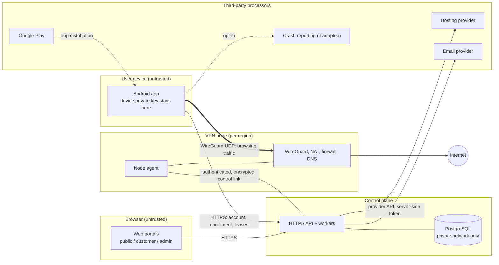

Draft — M01 — 15 Oct 2026 — pending review

# Threat model

Design-review threat model for Yashi VPN free v1 (M01–M09), plus the M10 billing scenario that [03](../team-pack/03-ARCHITECTURE-AND-CONTRACTS.md) requires. Sources: team pack v1.1, documents 01 §2–3, 02, 03 and 04, and milestones M03, M04, M07, M08, M09 and M10.

**State on 15 Oct 2026:** nothing is deployed and no user data exists. The API serves only `GET /v1/health`. No hosting provider is chosen, so every infrastructure control below is planned, not built (§6 lists what exists today). This draft is updated at the M04 handoff and executed in M08. The M01 gate needs review by the Android, backend and ops leads; none are invited yet, so only the owner can review it today.

Related: [data inventory](data-inventory.md) · [environments](../ops/environments.md) · [access matrix](../ops/access-matrix.md) · [secrets inventory](../ops/secrets-inventory.md) · [provider checklist](../ops/provider-checklist.md)

## 1. System context

| Component | What it does | What it holds | Trust |
|---|---|---|---|
| Android app | Account UI; generates the device key pair; composes the WireGuard config locally from a lease | Device private key (Keystore-backed protection where feasible), short-lived tokens, cached safe metadata | Untrusted: user-controlled device; the app can be modified |
| HTTPS control-plane API + workers | Identity, devices, plans/entitlements, node catalog, leases, usage/quota ledger, operations, support, privacy/deletion; billing in M10 | Signing keys, database and provider credentials (server-side only) | Trusted; only its HTTPS edge is public |
| Web portals | Public site, customer portal (User) and admin portal (AdminUser, MFA, roles) on separate routes and authorization | Session cookies only; never VPN traffic or device keys | Browser untrusted; admin realm separate |
| PostgreSQL | Control-plane data | Accounts, devices, leases, usage, audit, support | Trusted; private network only, never public |
| Node agent | The only component that changes peers and firewall rules on its node; typed commands; usage journal | Per-node credential; usage journal | Trusted for its own node only |
| VPN node | WireGuard endpoint, forwarding/NAT, firewall, DNS resolver (or third-party DNS, To decide) | Server private key; live peer state | Exposed to every tunnel client and to the internet |
| Third-party processors | Hosting (To decide), email (To decide), DNS if third-party (To decide), crash reporting if adopted (To decide), Google Play, GitHub (code and CI only) | Their own records of our data and traffic | External; terms and DPAs To verify |

Browsing traffic never passes through the API or the portals, and device private keys never leave the device (01 §2).

## 2. Trust boundaries

| ID | Boundary | What crosses it | Main planned controls |
|---|---|---|---|
| TB1 | Device ↔ control-plane API | HTTPS calls with tokens | TLS, short-lived tokens, server-side validation of every input and object |
| TB2 | Device ↔ VPN node | WireGuard UDP | WireGuard keys; the peer exists only while its lease is valid |
| TB3 | Browser ↔ API (public, customer, admin realms) | Sessions and cookies | Separate User and AdminUser authentication; MFA and roles for admins; CSRF protection, CSP, rate limits |
| TB4 | API ↔ PostgreSQL | SQL | Private network, no public port, least-privilege database users |
| TB5 | Control plane ↔ node agent | Typed commands, acknowledgements, usage deltas, heartbeats | Per-node credentials, encrypted link, no public agent API, idempotency |
| TB6 | Tunnel clients ↔ node host and private ranges | Client packets | Block metadata, link-local and private/management ranges (IPv4 and IPv6), node services and client-to-client traffic |
| TB7 | Node ↔ internet | User egress and DNS | No open resolver; egress abuse controls such as outbound SMTP blocking; no destination logging |
| TB8 | Our systems ↔ third-party processors | Provider API calls, email, crash data, Play | Server-side least-privilege tokens; DPAs To verify; processors listed in the privacy text |
| TB9 | Staff ↔ consoles, CI and admin portal | Privileged actions | Individual accounts, MFA, least privilege, audit ([access matrix](../ops/access-matrix.md)) |
| TB10 | Staging ↔ production | Reviewed code and artifacts only | Separate accounts, networks, databases, secrets and domains ([environments](../ops/environments.md)) |

## 3. Key assets

| Asset | Why it matters | Where it lives |
|---|---|---|
| Device WireGuard private keys | Decrypt or impersonate a user's tunnel | Device only; never uploaded, backed up or logged |
| Node WireGuard server private keys | Impersonate a node and its tunnels | The node only |
| Node agent credentials | Command peers and report usage for a node | Node; issuing CA in the control plane |
| Customer credentials and sessions | Account takeover | PostgreSQL (password hashes, hashed refresh tokens); device secure storage |
| Admin accounts, MFA factors, admin sessions | Control of users and fleet | PostgreSQL (AdminUser); staff devices |
| Signing keys (tokens, Play upload and app signing) | Forge sessions; ship a malicious app | Secret store; Google Play ([secrets inventory](../ops/secrets-inventory.md)) |
| Provider API tokens and owner accounts | Spend money; create, destroy or snapshot infrastructure | Secret store; owner |
| Account, device, lease, usage and support data | Personal data; quota integrity | PostgreSQL and backups ([data inventory](data-inventory.md)) |
| The privacy promise (no browsing, destination or DNS logs) | Product honesty; legal exposure | Node, DNS, proxy and logging configuration |
| Quota and entitlement integrity | Bandwidth cost and fairness | Usage ledger and node enforcement |
| Control-plane availability | Leases hard-expire, so a long outage disconnects everyone | API and database (plus standby) |
| Node IP reputation and provider standing | Abuse can get IPs blocklisted or the account suspended | Provider |
| Monthly budget | Owner ceiling of US$20/month for development and staging | Provider billing |

## 4. Threat scenarios

The 18 scenarios required by 03 ("Threat scenarios required in design review") plus the control-plane outage added in 03 v1.1. Residual risk is an initial estimate that assumes the planned mitigation is built and verified; re-rate it in M04 and M08. Lease figures use the initial proposal: renewal every 5 minutes, hard lifetime 15 minutes, margin 10 minutes.

| Threat | Impact | Planned mitigation (milestone) | Verification evidence (milestone) | Residual risk | Owner role |
|---|---|---|---|---|---|
| **T01 Stolen auth token.** An access or refresh token, or a web session cookie, is taken from a device, log or backup, or through XSS | The attacker acts as the user through the API: uses quota, revokes or enrolls a device, reads email, usage and tickets. The tunnel itself stays private because the device private key never leaves the device | M04: short-lived access tokens; refresh tokens rotated on use and stored hashed (AuthSession); reuse of an old refresh token revokes the session (proposed); reauthentication for password change and deletion; password change revokes other sessions; rate limits. M05: tokens in Keystore-backed storage, never in logs, backups or crash data; no debug trust bypass in release. M06: Secure, HttpOnly, SameSite cookies, CSRF protection, CSP. Users can list and revoke their sessions | M04: tests for expired, rotated, replayed and logged-out tokens; cross-user IDs denied. M05: on-device inspection of storage, logs and backups. M08: independent review of auth boundaries; inspection of logs, backups and crash payloads | **Medium.** A token stolen from a rooted or infected device works until it expires or rotation exposes reuse. No proof-of-possession binding in v1 (To decide). Without IP logging, misuse is hard to spot; this is a deliberate privacy trade-off | Web/backend engineer (Android engineer for device storage) |
| **T02 Malicious modified APK.** A repackaged app is distributed outside Play, or a modified client is used against the API | Users of a fake app can lose credentials and traffic privacy; brand damage; attempts to bypass quota, device or entitlement limits | M04: every limit enforced by the backend and the node; client flags never trusted (01 §3, 03). M05: no secrets or provider keys in the app; no debug, config-export or insecure-TLS code in release. M06/M09: distribution only through Play, with owner-controlled App Signing and upload key; the website links only to the real listing. App attestation (for example Play Integrity) and publishing the signing-certificate fingerprint: To decide | M04: the "cloned modified app" adversarial test cannot exceed one account's quota or device limit. M09: release AAB inspected for keys, debug flags and test endpoints. M08: authorization and quota attacks with a modified client | **Medium.** We cannot stop repackaged APKs outside Play or protect users who install them. Server enforcement limits a modified client to one account's entitlement; mass account creation is tracked in §5 | Android engineer (Owner for signing) |
| **T03 Leaked or stale tunnel configuration.** A config or key is copied off a device, or a config is kept after revoke, suspension, deletion, quota exhaustion or lease expiry | Use of the victim's quota; a revocation that does not remove access; the one-device limit bypassed | M04: server-enforced lease expiry; the agent removes peers on revoke or expiry and enforces locally when the control plane is unreachable; revoke, suspend and delete remove node access, not just the UI (01 §2). M03/M05: the key is generated and kept on the device; no config export in release | M04: stale-config-after-revoke test; revoke on a reachable node ≤60 s; a partitioned node cuts access at hard expiry. Staging check with an already-connected and an exported config (01 §2). M08: repeated in the attack run (04 matrix: Authorization) | **Low–Medium.** A leaked config works until revocation lands (≤60 s target on a reachable node) or the hard lease expires (≤15 min) on a partitioned node. Concurrent use of one key is hard to detect without IP logging | DevOps/security (node agent), with Web/backend engineer |
| **T04 Device public-key reuse.** The same WireGuard public key is enrolled twice: same or another account, after revoke or after deletion | Ambiguous peer identity: usage charged to the wrong account, one account displacing another's peer, a revoked key regaining access | M04: unique public key (03) across active and revoked devices; strict key-format validation; a fresh key pair per enrollment; transactional device-limit check; the agent refuses duplicate peer keys. Blocking keys of deleted accounts (keeping only a hash): To decide | M04: contract tests reject duplicates in the same account, in another account and after revoke; parallel enrollment test. M08: repeated in the attack run | **Low.** Enrolling someone else's public key gives no tunnel access, because the WireGuard handshake needs the private key | Web/backend engineer |
| **T05 Simultaneous quota grants.** Parallel lease or renew requests, retries or multi-region requests race past the allowance | Usage beyond 5 GiB/month and uncontrolled bandwidth cost; a quota bypass is a launch blocker (04) | M04: account-wide reservations allocated in one database transaction (QuotaReservation); outstanding plus consumed never exceeds the allowance plus a documented tolerance; one active free lease per account (unique constraint); idempotency keys; per-node reservation enforced by the agent; deduplicated usage deltas with epochs | M04: parallel-grant, duplicate-sample and node-reboot tests; overshoot within the measured bound (proposed ≤16 MiB per account per period). M08: concurrent grant and enrollment attack run (04 matrix: Quota) | **Low.** Overshoot up to the measured tolerance is accepted and disclosed. Transaction-isolation bugs remain possible until tested under load | Web/backend engineer |
| **T06 Agent compromise.** An attacker controls a node agent or the whole node: exploit, stolen agent credential or SSH key, provider console access | For users on that node: destinations and DNS could be logged (breaking the privacy promise), unencrypted traffic tampered with, rogue peers added, usage and heartbeats faked, the server key stolen; attempts to pivot into the control plane | M03/M04: root only for bootstrap; the agent keeps only the capabilities WireGuard and the firewall need; per-node credentials, revocable independently; the control plane accepts commands and reports from an agent only for its own node; typed commands, no shell; usage reports bounded by reservations; SSH keys only, restricted management, pinned Ubuntu LTS. M07: quarantine and drain; rebuild rather than repair (04 runbooks: leaked node key; node down/drain/replace) | M04: node A's credential cannot act for node B or read other data. M07: credential-rotation runbook test. M08: independent review of agent permissions; agent restart and certificate rotation drills | **High impact; likelihood not yet assessed.** A fully compromised node exposes metadata and any non-HTTPS traffic of every user routed through it until detected. Host intrusion detection: To decide. A compromise on the provider side is outside our control | DevOps/security |
| **T07 Spoofed heartbeat.** A forged or replayed heartbeat, health report or acknowledgement | Users sent to broken nodes; a pending revocation reported as complete; the catalog shows false availability | M04: heartbeats and acknowledgements accepted only on the authenticated per-node channel, with sequence and timestamp replay checks; a revocation is complete only when the agent acknowledges the exact desired generation; uncertain state quarantines the node and stops new leases (03). External probe of tunnel endpoints: To decide. M05: the app shows Connected only after its own in-tunnel check (01 §3) | M04: replayed and foreign-credential heartbeats rejected. M07: the admin portal shows heartbeat age and never reports a drain or revoke complete early. M08: heartbeat-loss drill (04 matrix: Resilience) | **Medium.** A compromised agent with valid credentials can still lie about its own node (T06); external probing reduces this but does not remove it | DevOps/security |
| **T08 Billing replay (M10).** An old, refunded or other account's Play purchase token is replayed | Premium access without payment; lost revenue; extra capacity cost | Free v1: no billing endpoint exists before M10. M10: backend verification with Google Play; never trust a premium flag from the app (03); dedupe by purchase token and order ID; one account per purchase; notification handling, re-query and reconciliation; refunds and revocations remove the entitlement | M10: sandbox and license tests, including replay to another account, duplicate or delayed notifications, refunds and restore on another device | **Not applicable before M10.** In M10 a window between a refund and its processing is expected; size it then | Web/backend engineer (M10) |
| **T09 Privilege escalation across accounts.** IDOR (user A acts on user B's device, lease, ticket or diagnostics), a customer token used on admin endpoints, or an admin role exceeding its permissions | Personal-data exposure; unauthorized revoke or deletion; fleet control by an unprivileged user | M04: server-side ownership check on every object operation; deny by default. M06: CSRF protection, CSP, input validation. M07: separate AdminUser realm, mandatory MFA, roles (Owner, Operator, Support, Read-only) enforced on every endpoint, step-up and a reason for disruptive actions, audit | M04: cross-user object-ID tests. M06: unauthorized object access fails. M07: MFA, role and IDOR tests pass. M08: authorization attack run and independent review (04 matrix: Admin) | **Medium.** Every new endpoint can reintroduce IDOR; per-endpoint tests are the control. An external penetration test is recommended (M08); if it is skipped, disclose that | Web/backend engineer |
| **T10 Provider API key exposure.** A hosting API token leaks through Git, CI logs, the admin UI, a laptop or chat | Servers created or destroyed, disks and snapshots read (node keys, database), firewalls changed, bills beyond the ceiling | M01: CI secret scan, `.gitignore` for key files, [secrets inventory](../ops/secrets-inventory.md). M03/M04: tokens server-side only, least privilege, one per environment and purpose; owner-held provider account with MFA; budget alerts at 50/75/90% (04). M07: tokens never reach the browser. Runbook: leaked provider token (04) | M01: CI secret-scan job (exists). M04: secret-redaction report. M07: browser inspection shows no cloud credentials; rotation runbook test. M08: logs and backups inspected for secrets | **Medium.** Token scoping depends on the provider (To verify). Provider alerts may not be hard spend caps (To verify), so a leak can cost money before the token is revoked | DevOps/security |
| **T11 DNS leak.** DNS queries leave outside the tunnel: OS or OEM behavior, IPv6 resolvers, captive portals, misconfiguration | The local network or ISP sees the domains visited, contradicting how the product describes its protection | M03: the lease supplies approved DNS routed inside the tunnel, with full-tunnel routes (03). Resolver on the node or a third party: To decide (a third party must be disclosed). M05: document behavior when Android Private DNS or app-level encrypted DNS is in use (To verify per device) | M03: no unintended DNS bypass in full-tunnel tests; unsafe routing blocks M04. M08: DNS tests on several real devices and networks (04 matrix: Routing) | **Low–Medium.** OEM and Android-version differences; limited test networks. Traffic outside the VPN while disconnected with OS lockdown off is expected and must be explained in the app | Android engineer, with DevOps/security |
| **T12 IPv6 leak.** IPv6 traffic bypasses an IPv4-only tunnel on dual-stack networks | The real IP address and traffic are exposed; the nominal full tunnel is broken | M01/M03 decision: route IPv6 fully or block it inside the tunnel; never let it escape silently (03). The node firewall covers IPv6, including ULA and link-local. Depends on provider IPv6 support ([provider checklist](../ops/provider-checklist.md) Q4) | M03: IPv6 bypass tests on dual-stack Wi-Fi and mobile networks. M08: repeated on several real devices and carriers | **Low–Medium.** Untested OEM and network combinations remain. If IPv6 is blocked, some IPv6-only services may fail (usability, not a leak) | DevOps/security, with Android engineer |
| **T13 Open resolver.** A node's DNS resolver answers queries from the internet | DNS amplification from our IPs; abuse complaints, blocklisting, possible provider suspension | M03: the resolver listens on tunnel addresses only; the firewall drops public port 53 (IPv4 and IPv6); query logging off; configuration kept in infrastructure code (03) | M03: a query from outside the tunnel fails (task 7). M08: repeated on a production-like configuration; repeated after every node build (proposed) | **Low** if the post-build check is automated; configuration drift is the remaining risk | DevOps/security |
| **T14 App killed with exhausted quota.** The app is killed, offline or modified while the tunnel stays up and the quota runs out | Usage beyond the allowance if enforcement depended on the app | M04: the node enforces its reservation with local counters and firewall policy and removes the peer on exhaustion; lease expiry does not depend on the app (03). M05: Exhausted state and OS lockdown explanation (02) | M04: exhaustion test with the app killed and the backend unavailable (03). M08: repeated in the attack run (04 matrix: Quota) | **Low.** Overshoot is bounded by the sampling interval (proposed ≤16 MiB, to be measured). Users with OS lockdown lose internet until the reset or a settings change; this is explained beforehand (01 §3) | DevOps/security (node agent) |
| **T15 Region switch during revocation.** The user switches region, or retries, before the old node acknowledges the revoke | Two active peers for one free account, double use of quota, or escape from a suspension | M04: one active free lease per account; switching is a controlled transition (01 §3); an unused reservation is returned only after the old peer is actually revoked or its lease has expired; no new lease while suspended or while deletion is pending; switching never erases usage (03) | M04: "switch before old node acknowledges revoke" test. M08: switch attack (04 matrix: Quota) | **Low** for overspend. Availability cost: if the old node is unreachable, the user may wait up to the hard lease lifetime (≤15 min); the policy for this case is To decide | Web/backend engineer |
| **T16 Metadata service access.** A VPN client reaches cloud metadata, link-local or private management ranges, node services or other peers through the tunnel | Theft of instance metadata (and any secrets placed in it), lateral movement to the control plane, client-to-client attacks | M03: the node firewall blocks tunnel traffic to metadata and link-local addresses (IPv4 and IPv6), private and ULA management ranges, node services and other peers (03); no long-lived secrets in instance user-data (proposed) | M03: client-isolation and metadata-denial tests (task 7). M08: repeated on several devices and networks | **Low.** Provider-specific metadata addresses and private ranges must be confirmed per provider (To verify); each new image needs the same test | DevOps/security |
| **T17 Fake Connected state.** The app or its notification shows Connected without a working tunnel: interface up only, a stale check, animation-driven state, prototype code | The user believes their traffic is protected when it is not; misrepresentation (01 §3) | M03/M05: Connected only after a handshake plus a recent app-controlled reachability check inside the tunnel; stale verification shows Checking connection or Connection issue (02); UI and notification derive from the service state; no debug controls in release. M06: the website never shows a Connected state | M03: no premature or false green status. M05: UI and notification match the actual state; loss and stale checks change the status. M08: UI regression on the device matrix (04 matrix: Connection) | **Low–Medium.** Between checks, a failure still shows Connected until the next check (interval To decide); a passing check does not prove that every destination works | Android engineer (QA verifies) |
| **T18 Support attachment abuse.** Malicious or oversized uploads (HTML or SVG with script, malware, polyglot files), or attachments full of personal data | Script or malware run against support and admin staff, who hold high privilege; storage cost; unnecessary personal data | M04/M06: attachment restrictions (03): type allow-list, size limits, images re-encoded with metadata stripped (proposed), served as downloads from an isolated origin with a strict CSP, never rendered inline; owner-scoped access. M07: the Support role sees minimal data. Retention 90 days after close (04). Whether v1 accepts attachments at all: To decide | M06: upload-restriction tests (blocked types, size, content sniffing). M07: role tests on ticket access. M08: injection tests (04 matrix: Admin) | **Medium** if attachments are enabled: users can still upload personal data in screenshots. Malware scanning: To decide | Web/backend engineer |
| **T19 Control-plane outage longer than the lease margin** (03 v1.1). The API or database is down for longer than the hard lifetime minus the renewal interval (10 min with the initial proposal) | Leases cannot renew, so every connected user is disconnected; new connections fail closed; risk of client retry storms | M04: new grants fail closed; existing peers continue only within their unexpired lease and reservation. M05: bounded retries with jitter (01 §3). Before launch (M08/M09): a restorable standby for API and database (or a managed database); failover or restore inside the margin; rolling or short maintenance; alerts on lease-renewal failures (03). Changing lease timing needs security review and owner approval | M07: alert drill. M08: API and database loss drill. Launch gate (04): the failover/restore drill finishes inside the margin without disconnecting existing users | **Medium.** By design, an outage beyond the margin disconnects everyone (security over availability). A standby with the same provider or region shares its failures. Staging under US$20/month has no permanent standby, so drills need a temporary one | DevOps/security (Owner approves the standby budget) |

## 5. Other threats to model by M04/M08

Not in the 03 list, but likely:

- **Free-tier abuse through many accounts.** Rate limits, email verification and enrollment caps, without invasive fingerprinting (01 §3).
- **Abuse from exit IPs** (spam, scanning, attacks, copyright complaints) leading to blocklisting or provider suspension. Acceptable-use policy, outbound SMTP blocking (03), 04 runbook "account abuse", provider expectations ([provider checklist](../ops/provider-checklist.md) Q2, Q9).
- **Takeover of owner accounts** (GitHub, Play Console, hosting, registrar, email). MFA, recovery codes kept offline, 04 runbook "compromised admin".
- **Supply chain:** dependencies, CI workflows and third-party GitHub Actions, which CI currently references by version tag rather than commit SHA. Dependabot, CODEOWNERS and secret scanning exist; pinning actions to commit SHAs is proposed.
- **Denial of service against the API or nodes.** Provider DDoS handling To verify; rate limits; fail-closed design.
- **Domain and DNS hijack** once a domain exists. Registrar lock, MFA, CAA records (proposed).
- **Legal requests for user data.** Data minimization; the handling process is To decide after legal review.

## 6. Controls already in the repo (15 Oct 2026)

| Control | Evidence |
|---|---|
| API request logs record method, matched route pattern, status and a server-generated request ID only; never client IPs, query strings, headers or bodies | `api/src/server.ts` |
| Client-supplied request IDs ignored; `no-store` responses; error bodies without stack traces | `api/src/app.ts` |
| Android cloud backup and device-to-device transfer disabled for all app data | `android/app/src/main/AndroidManifest.xml`, `android/app/src/main/res/xml/data_extraction_rules.xml` |
| `.env`, key, keystore and service-account files ignored by Git | `.gitignore` |
| CI secret scan (gitleaks), dependency audit (high and critical), read-only workflow token | `.github/workflows/ci.yml` |
| Weekly dependency updates; the owner is code owner for every path | `.github/dependabot.yml`, `.github/CODEOWNERS` |
| Protected `main` branch | To verify in GitHub settings; may depend on the GitHub plan for private repositories ([access matrix](../ops/access-matrix.md)) |

## 7. Review and updates

- Reviewers: Android, backend and ops leads plus the owner (M01 gate). Security-sensitive changes need a second reviewer (00).
- Update at the M04 handoff, at M07 (admin roles), with M08 findings, whenever a processor, provider or region is added, and before any lease-timing change (security review and owner approval, 03).
- Only the owner accepts a residual risk, in writing, with a review date.
